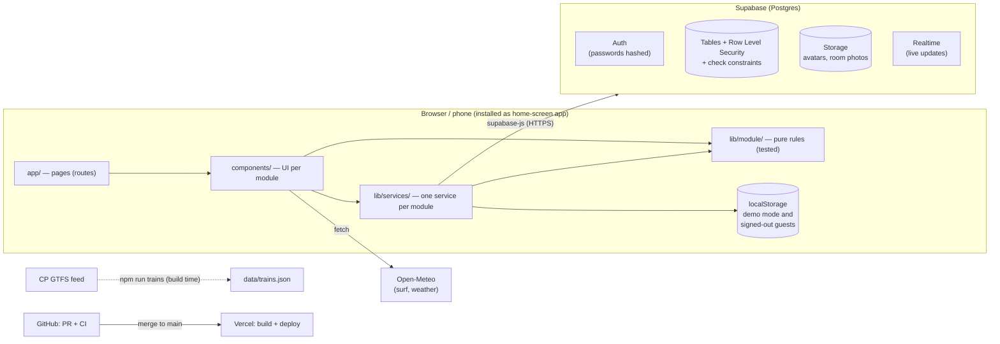

# Architecture

How the app is built, why it is built that way, where its limits are and how it could change.
Use this as the map for a walkthrough of the repository.

## 1. The big picture

Four layers, each in its own folder. A component never talks to Supabase directly, it always
goes through a service:

| Layer      | Folder                 | Job                                                                    | Example                                |
| ---------- | ---------------------- | ---------------------------------------------------------------------- | -------------------------------------- |
| Pages      | `app/`                 | One folder per URL; sets the title and puts components on the page     | `app/sport/padel/page.tsx`             |
| Components | `components/<module>/` | What the user sees and clicks; holds UI state                          | `components/sport/padel/MatchCard.tsx` |
| Services   | `lib/services/`        | Reads and writes data: Supabase or localStorage                        | `lib/services/padel.service.ts`        |
| Rules      | `lib/<module>/`        | Pure functions: validation, sorting, calculations; no I/O, unit tested | `lib/padel/matches.ts`                 |
| Contracts  | `types/`               | The shape of the data and each service's interface                     | `types/padel.ts`                       |

## 2. One workflow end to end: "Ask to join a padel match"

1. `MatchCard` shows **Ask to join**. The user writes a note and taps **Send request**.
2. `PadelView` calls `padelService.requestToJoin(matchId, userId, note)`.
3. The service first runs the pure rule `checkCanRequest` from `lib/padel/matches.ts`
   (not your own match, not already playing, not full, note ≤ 200). A problem becomes a clear
   message in the card.
4. It inserts a row into `padel_join_requests`. **The database checks again**: RLS only allows a
   row with your own `user_id` and `status = 'pending'`, never for your own match.
5. Supabase Realtime tells the organiser's phone; their card shows "1 request to join".
6. **Accept** calls the database function `padel_respond_to_request`. It checks that the caller
   organises the match, adds the player and marks the request. The capacity trigger refuses a
   full court even if two people accept at the same moment.

Every shared feature (rooms, messages, profiles) follows the same path:
**component → service → pure rule → Supabase (RLS + constraints) → Realtime**.

## 3. Why it is built this way

| Decision                                                                                        | Why                                                                                                                        | Trade-off                                                                                        |
| ----------------------------------------------------------------------------------------------- | -------------------------------------------------------------------------------------------------------------------------- | ------------------------------------------------------------------------------------------------ |
| **Next.js App Router + React + TypeScript**                                                     | One codebase for all pages, types catch mistakes early, deploys to Vercel with zero config                                 | Next.js 16 is new; some APIs differ from tutorials (see `AGENTS.md`)                             |
| **Service layer with two implementations** (`AUTH_MODE`: `"accounts"` or `"demo"`)              | Every teammate can work and demo without a Supabase account; components don't care where data lives; services are testable | Two code paths per shared service                                                                |
| **Pure rules in `lib/<module>/`**                                                               | Easy to unit test; the same rule runs before saving and gives friendly messages                                            | Rules exist twice: in TypeScript and as database constraints                                     |
| **Supabase** (Postgres, Auth, Storage, Realtime)                                                | Real accounts, shared data and live updates without writing our own server                                                 | We depend on one provider; free tier limits                                                      |
| **Security in the database (RLS)**, not only in the UI                                          | A modified client or a direct API call can't read others' chats or delete others' listings                                 | Policies are SQL and need care; checked by `lib/security/security.test.ts`                       |
| **Data loaded in the browser** (client components)                                              | Sessions live in the browser; pages stay a static shell that loads instantly (Cache Components)                            | First load of shared data needs a request; no server-side rendering of personal data             |
| **Personal data as one JSON document per user** (`personal_data`: timetable, to-dos)            | Same on every device; one private row per user and kind, guarded by RLS; the services' logic stays the same                | Last save wins if two devices change the same thing at the same moment; no live sync while open  |
| **Train timetable compiled from CP's official GTFS feed** (`scripts/build-train-timetable.mjs`) | Exact times incl. holidays, no API at runtime, fast                                                                        | Needs re-running when CP changes the timetable (the app says when data runs out); no live delays |
| **One branch + PR per feature, CI on every PR**                                                 | Clear authorship, review, nothing reaches `main` without lint, types, tests and build                                      | Merge order matters when features overlap                                                        |
| **Pinned dependencies, few of them**                                                            | Same build everywhere; small attack surface; `npm audit` in CI                                                             | Updates are manual                                                                               |

## 4. Data and security model

| Data                             | Where                                                         | Who can read                                      | Who can write                                        |
| -------------------------------- | ------------------------------------------------------------- | ------------------------------------------------- | ---------------------------------------------------- |
| Account, password                | Supabase Auth (bcrypt hash)                                   | nobody (not even us)                              | the user                                             |
| Profile                          | `profiles`                                                    | signed-in users (e-mail hidden via column grants) | only the owner                                       |
| Profile picture                  | Storage `avatars`                                             | public URL                                        | only the owner's folder                              |
| Padel matches, players, requests | `padel_matches`, `padel_match_players`, `padel_join_requests` | signed-in users; requests only you + organiser    | create/cancel own; join only via an accepted request |
| Room listings + photos           | `room_listings`, Storage `room-photos`                        | signed-in users                                   | create/delete own                                    |
| Messages                         | `messages`                                                    | only sender and recipient                         | send as yourself; recipient may only set `read_at`   |
| Timetable, to-dos                | `personal_data` (one JSON row per user and kind)              | only the owner                                    | only the owner                                       |
| Train settings                   | localStorage                                                  | this device                                       | this device                                          |

- Inputs are validated three times: HTML limits (`maxLength`, `required`), the pure rule
  (friendly message), and the database (`check` constraints, RLS).
- No secrets in the repo: only the public _publishable_ key is used in the browser; `.env.local`
  is git-ignored; a test fails if a secret key is committed.

## 5. Limits (honest list)

- **Personal data syncs on load, not live**: timetable and to-dos are saved per account, but
  another device only shows a change when the page is opened again (the home page also refreshes
  when you come back to it). If two devices change them at the same moment, the last save wins.
- **No push notifications** yet; reminders go through calendar files (`.ics`).
- **No moderation**: no report/block for listings or messages.
- **Train data is static**: no delays; must be regenerated when the feed runs out.
- **No live Uber prices**: Uber only offers deep links to the public.
- **Supabase free tier**: limited auth e-mails per hour, so e-mail confirmation is off for the demo.
- **Not end-to-end encrypted chat**: messages are protected by RLS, not encryption.
- **Tests are unit tests**: services are tested in demo mode; RLS is checked statically, not
  against a running database; no browser end-to-end tests.

## 6. How it could change

| Next step                               | What changes                                                                                                                        |
| --------------------------------------- | ----------------------------------------------------------------------------------------------------------------------------------- |
| Push notifications                      | Web Push (works on iPhone for home-screen apps) + a scheduled Supabase Edge Function for reminders                                  |
| Microsoft sign-in with the Nova account | Already prepared behind `NEXT_PUBLIC_MICROSOFT_LOGIN` (see `docs/microsoft-login.md`); needs an Azure app registration from Nova IT |
| Report and block                        | `reports` table + an admin view; hide messages from blocked users in the message policy                                             |
| End-to-end tests                        | Playwright against a Supabase test project, run in CI                                                                               |
| Live train delays                       | Swap `data/trains.json` for a live feed behind the same `nextTrains` function                                                       |

## 7. Adding a new module (checklist)

1. `types/<module>.ts`: data shape and service interface.
2. `lib/<module>/`: pure rules + `*.test.ts` (accepted, rejected, edge cases).
3. `lib/services/<module>.service.ts`: demo (localStorage) and, if shared, Supabase implementation.
4. If shared: a new file in `supabase/migrations/` with the table, `check` constraints, RLS
   policies and grants. Run it once in the Supabase SQL Editor and list it in `docs/accounts.md`.
5. `components/<module>/` and `app/<route>/page.tsx`; add it to `lib/config/navigation.ts`.
6. Branch, PR, CI green, teammate review, merge: Vercel deploys automatically.
